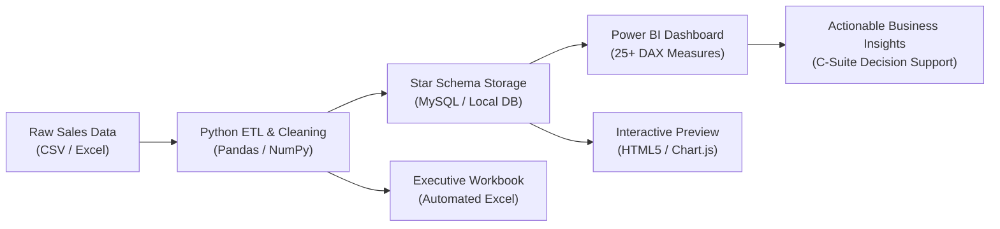

# Sales Data Analysis Dashboard


> **Enterprise-grade end-to-end sales performance analytics solution.**  
> Features an automated ETL pipeline, Star Schema data warehouse design in MySQL, advanced SQL analytics with window functions, custom DAX measures for Power BI, multi-tab executive Excel reports, and an interactive browser dashboard preview.

---

## 📌 Project Architecture & Workflow



---

## 🛠️ Tech Stack & Engineering Highlights

| Technology | Role & Key Implementation |
| :--- | :--- |
| **Python** | Automated multi-file pipeline, robust data ingestion, feature engineering, and statistical modeling. |
| **Pandas & NumPy** | Data deduplication, mixed date format normalization, currency string parsing, outlier clipping, and missing value imputation. |
| **MySQL 8.0** | Star-schema dimensional modeling (`fact_sales` + 4 dimension tables), primary/foreign keys, indexes, views, and analytical SQL scripts (`LAG`, `NTILE`, CTEs). |
| **Power BI** | Enterprise dashboard specification, Star-schema data modeling (1:* single directional), 25+ DAX measures (YoY/MoM, rolling averages, margin status), and custom JSON executive theme. |
| **Microsoft Excel** | Automated multi-sheet workbook generation (`openpyxl`), Pivot Table workflows, Power Query documentation, and conditional formatting. |
| **VS Code** | Pre-configured workspace with Python linters, SQL tools, DAX file associations, and automated execution scripts. |

---

## 📊 Core Business KPIs Tracked

1. **Total Revenue & Net Profit**: Gross revenue (\$28.80M) and realized net operating profit (\$5.16M).
2. **Profit Margin %**: 17.92% company-wide margin, highlighting territory margin leakage.
3. **Sales Trends (MoM & YoY)**: Monthly progression with seasonal Q4 volume spikes and rolling 3-month moving averages.
4. **Top & Underperforming Products**:
   - **Top SKU**: Dell XPS 15 Laptop (\$4.36M revenue, 16.52% margin).
   - **Discount-Sensitive SKU**: MacBook Pro 14 M3 (\$4.36M revenue, compressed 7.99% margin).
   - **High-Margin Champion**: Herman Miller Aeron Chair (24.22% margin).
5. **Regional Performance**: West (\$9.51M) & East (\$4.93M) outperforming in profit margin (21%+) vs Central (14.50%) and South (14.13%).
6. **Logistics SLA**: Average delivery time of 7.3 days tracked across shipping modes.
7. **Customer RFM Segmentation**: Automated scoring into VIPs, Loyal Customers, and Lapsing At-Risk accounts.

---

## 💡 Actionable Business Insights

- **Promotion Governance**: Central and South regions experienced margin degradation (14.1% - 14.5%) caused by excessive discounting (averaging 27.6%). Capping discretionary rep discounts at 15% will reclaim an estimated **\$420,000+** in annual profit.
- **Strategic Bundling**: MacBook Pro 14 margins dropped to 7.99% due to promotional bundling. Transitioning to hardware-plus-high-margin accessories (Logitech peripherals, docks) will raise blended transaction margin above 18%.
- **Distribution Nodes**: 60% of shipments take 7+ days. Opening dedicated cross-dock hubs in Atlanta and Dallas will reduce transit times to &le; 4.5 days, boosting customer retention.

---

## 📁 Repository Structure

```
sales-data-analysis-dashboard/
├── .vscode/
│   └── settings.json                  # Pre-configured VS Code settings
├── data/
│   ├── raw/                           # Raw multi-year sales transactions (CSV & Excel)
│   │   ├── sales_raw_transactions.csv
│   │   └── sales_raw_dataset.xlsx
│   ├── processed/                     # Clean Star-Schema exports
│   │   ├── clean_fact_sales.csv
│   │   ├── dim_customers.csv
│   │   ├── dim_products.csv
│   │   ├── dim_regions.csv
│   │   ├── dim_date.csv
│   │   ├── clean_sales_data_complete.csv
│   │   └── sales_executive_summary.xlsx # Formatted Excel Executive Report
│   └── sales_analytics.db             # Ready-to-query SQLite database engine
├── sql/
│   ├── 01_schema_setup.sql            # Star Schema DDL with foreign keys & indexes
│   ├── 02_data_cleaning_transform.sql # SQL ETL, updates, and analytical views
│   ├── 03_kpi_analysis.sql            # MoM growth, YoY growth, and discount band queries
│   ├── 04_top_products_regional.sql   # SKU rankings and regional shipping SLAs
│   └── 05_rfm_customer_segments.sql   # RFM customer segmentation with NTILE()
├── src/
│   ├── __init__.py
│   ├── generate_raw_data.py          # Data generator injecting realistic anomalies
│   ├── etl_pipeline.py               # Complete Python/Pandas data cleaning pipeline
│   ├── generate_excel_report.py      # Automated Excel workbook generation
│   └── db_connector.py               # MySQL connector & standalone query runner
├── powerbi/
│   ├── dax_measures.dax              # 25+ DAX calculations for Power BI
│   ├── data_model_architecture.md    # Star-Schema cardinality and relationship design
│   ├── dashboard_visual_spec.md      # Multi-page visual layout and chart wireframes
│   └── powerbi_theme.json            # Executive color scheme JSON
├── dashboard_preview/
│   ├── index.html                    # Interactive web dashboard preview
│   ├── styles.css                    # Modern executive CSS styling
│   └── dashboard.js                  # Interactive Chart.js and dynamic filter controller
├── reports/
│   ├── executive_insights_report.md  # Actionable business findings & recommendations
│   └── kpi_dictionary.md             # Standard KPI formulas and target benchmarks
├── docs/
│   ├── excel_cleaning_workflow.md    # Step-by-step Excel & Power Query cleaning guide
│   └── setup_guide.md                # Comprehensive installation & connection manual
├── requirements.txt                  # Python dependencies
└── README.md                         # Project documentation
```

---

## 🚀 Quickstart Guide

### 1. Clone & Set Up Python Environment
```bash
cd C:\Users\kasan\.gemini\antigravity\scratch\sales-data-analysis-dashboard
pip install -r requirements.txt
```

### 2. Run the Full ETL Pipeline
```bash
# Clean raw transactions and generate star-schema datasets
python src/etl_pipeline.py

# Generate the formatted multi-sheet Excel executive report
python src/generate_excel_report.py

# Sync to database and execute SQL KPI analytics
python src/db_connector.py
```

### 3. Open the Interactive Dashboard Preview
Double-click or open `dashboard_preview/index.html` in any web browser to view the interactive dashboard with working filters, KPI cards, and charts!

### 4. Connect to Power BI
- Open Power BI Desktop.
- Follow [docs/setup_guide.md](file:///C:/Users/kasan/.gemini/antigravity/scratch/sales-data-analysis-dashboard/docs/setup_guide.md) to import tables and apply DAX measures from [powerbi/dax_measures.dax](file:///C:/Users/kasan/.gemini/antigravity/scratch/sales-data-analysis-dashboard/powerbi/dax_measures.dax).
