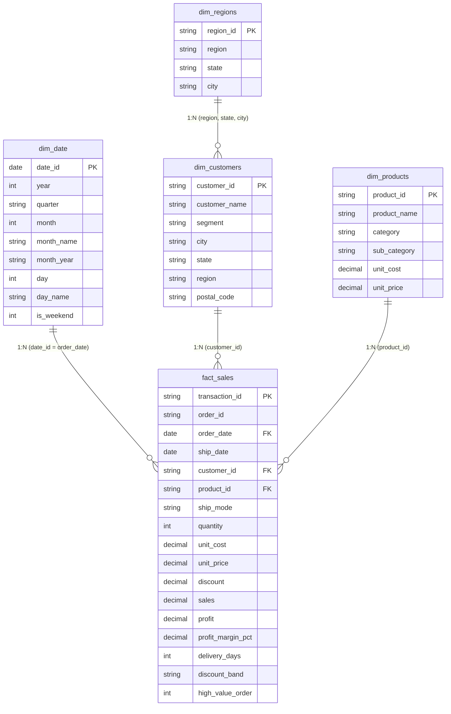

# Power BI Data Model Architecture & Schema Design

## 1. Overview
The data model follows an industry-standard **Star Schema** architecture optimized for high-performance Power BI in-memory VertiPaq analytics. It segregates observational sales data into a central fact table surrounded by clean, denormalized dimension tables.

---

## 2. Table Cardinalities & Cross-Filtering

| From Table (Dimension) | To Table (Fact) | Relationship Type | Cardinality | Cross Filter Direction | Active |
| :--- | :--- | :--- | :--- | :--- | :--- |
| `dim_date[date_id]` | `fact_sales[order_date]` | Primary Date Relationship | 1 : * (One-to-Many) | Single | **Active** |
| `dim_date[date_id]` | `fact_sales[ship_date]` | Secondary Date Relationship | 1 : * (One-to-Many) | Single | Inactive (`USERELATIONSHIP`) |
| `dim_customers[customer_id]` | `fact_sales[customer_id]` | Customer Dimension | 1 : * (One-to-Many) | Single | **Active** |
| `dim_products[product_id]` | `fact_sales[product_id]` | Product Dimension | 1 : * (One-to-Many) | Single | **Active** |

### Key Modeling Best Practices Implemented:
1. **Single-Direction Filtering**: All relationships filter from Dimension (1) to Fact (*). Bidirectional filtering is deliberately avoided to prevent circular dependencies, ambiguous filter paths, and VertiPaq performance degradation.
2. **Date Table Configuration**: `dim_date` is marked as the official **Date Table** in Power BI (`Mark as Date Table` -> Select `date_id`), ensuring accurate operation of all Time-Intelligence functions (`SAMEPERIODLASTYEAR`, `TOTALYTD`, `DATEADD`).
3. **Column Formats & Sort Orders**:
   - `dim_date[month_name]` is sorted by `dim_date[month]`.
   - `dim_date[month_year]` is sorted by `dim_date[year]` and `dim_date[month]`.
   - Categorical dimensions are pre-trimmed and indexed in Python/SQL before loading.
